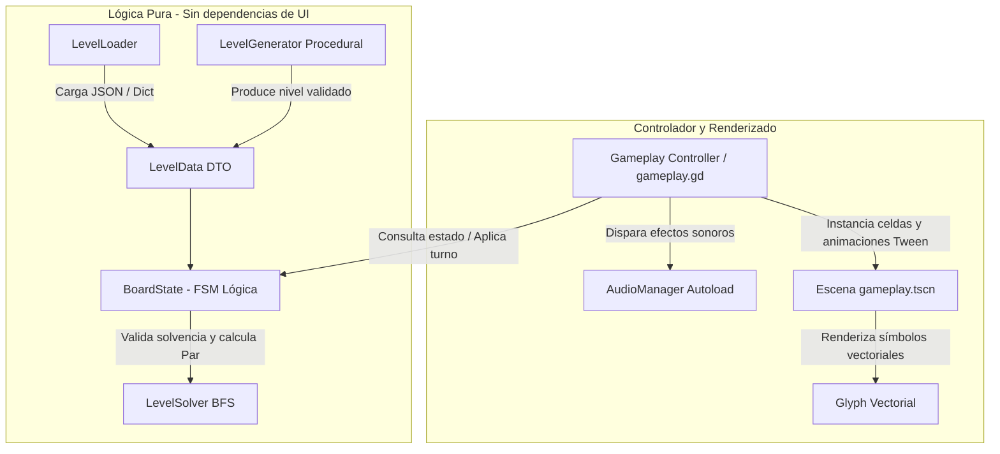

# KROMA // Spatial Logic & Chromatic Synthesis

<div align="center">


**Experiencia minimalista de resolución de puzles basada en inercia discreta, síntesis cromática y mutación topológica.**

[Características](#visión-general-del-proyecto) •
[Reglas del Juego](#reglas-mecánicas-y-álgebra-cromática) •
[Arquitectura Técnica](#especificación-técnica-y-arquitectura) •
[Estructura del Proyecto](#estructura-del-repositorio) •
[Despliegue y Ejecución](#instalación-y-ejecución) •
[Créditos](#créditos-del-estudio)

---

</div>

## Visión General del Proyecto

**KROMA** es un videojuego de lógica espacial en dos dimensiones desarrollado sobre **Godot Engine 4**. El jugador opera sobre cuadrículas ortogonales discretas (de $5\times 5$ a $7\times 7$ celdas) donde las entidades activas carecen de coeficiente de fricción, proyectándose de forma continua a lo largo de los cuatro ejes cardinales hasta colisionar contra obstáculos perimetrales o estructurales.

El diseño del juego articula tres principios fundamentales:
1. **Desplazamiento inercial discreto:** La fuerza cinética no decae hasta encontrar un obstáculo rígido o borde del mapa.
2. **Síntesis cromática determinista:** La interacción física entre primarios genera colores secundarios irreducibles.
3. **Mutación topológica progresiva:** Al resolver un objetivo, la pieza encajada se transmuta en un muro rígido permanente (`LOCKED`), reconfigurando en tiempo real el grafo de trayectorias transitables y habilitando nuevos giros a 90°.

---

## Reglas Mecánicas y Álgebra Cromática

### 1. Inercia Discreta y Colisiones
* Cada bloque activo se desplaza celda por celda sin pérdida de energía mediante raycasting lógico discreto.
* El frenado se produce en la celda previa al impactar contra un muro estático, un bloque encajado o el borde perimetral del tablero.

### 2. Álgebra de Síntesis Cromática
La colisión frontal entre entidades de pigmentación primaria genera una transición determinista hacia un estado secundario:

$$\begin{aligned}
\text{🔴 Rojo} &+ \text{🔵 Azul} &\longrightarrow &\text{ 🟣 Púrpura} \\
\text{🔵 Azul} &+ \text{🟡 Amarillo} &\longrightarrow &\text{ 🟢 Verde} \\
\text{🟡 Amarillo} &+ \text{🔴 Rojo} &\longrightarrow &\text{ 🟠 Naranja}
\end{aligned}$$

> **Regla de Conveniencia:** Las entidades secundarias resultantes constituyen estados terminales estables; colisionar dos secundarios o un secundario contra un primario no genera reacción y actúa como tope físico rígido.

### 3. Glifos Geométricos de Accesibilidad Universal
Para garantizar la accesibilidad integral y el juego sin barreras para personas con deficiencias en la percepción del color (daltonismo y discromatopsia), cada canal cromático está acoplado de forma unívoca a un glifo geométrico vectorial:

| Tono | Canal Cromático | Símbolo Geométrico | Comportamiento |
| :---: | :---: | :---: | :--- |
| 🔴 | **Rojo** | `Círculo` | Entidad Primaria |
| 🔵 | **Azul** | `Cuadrado` | Entidad Primaria |
| 🟡 | **Amarillo** | `Triángulo` | Entidad Primaria |
| 🟣 | **Púrpura** | `Rombo` | Síntesis Secundaria (Rojo + Azul) |
| 🟢 | **Verde** | `Cruz` | Síntesis Secundaria (Azul + Amarillo) |
| 🟠 | **Naranja** | `Hexágono` | Síntesis Secundaria (Amarillo + Rojo) |

### 4. Abismos Estructurales (`voids`)
Celdas de disrupción topológica carentes de sustrato físico. Si una pieza cruza sus coordenadas, es aniquilada de inmediato fuera de la simulación.

### 5. Detección Formal de Derrota (*Fail State*)
El motor lógico (`BoardState`) evalúa matemáticamente el tablero después de cada acción para prevenir estados "zombi" e informar de inmediato al usuario cuando el sector se vuelve irresoluble:
* **Insuficiencia Numérica:** $\text{Bloques Libres} < \text{Receptores Pendientes}$.
* **Incompatibilidad Cromática:** La pérdida de una pieza primaria en un abismo impide sintetizar el color exacto exigido por los receptores restantes.
* **Deadlock Cinemático:** Ninguna entidad activa dispone de movimientos válidos en ninguno de los cuatro ejes cardinales.
* **Feedback de Recuperación:** Bloqueo de inputs de traslación, notificación visual en pantalla y recuperación inmediata mediante `[Z]` Deshacer o `[R]` Reiniciar.

---

## Mapeo de Entradas y Controles

| Comando | Teclado Primario | Mapeo Alternativo / UI | Función Técnica |
| :--- | :---: | :---: | :--- |
| **Desplazamiento** | `W` `A` `S` `D` | `↑` `←` `↓` `→` | Proyecta vector cardinal continuo hasta colisión. |
| **Conmutación** | `Tab` | `Espacio` | Itera cíclicamente entre los bloques activos libres. |
| **Deshacer (Undo)** | `Z` | Botón HUD | Restaura el snapshot inmediato anterior desde la pila LIFO. |
| **Reiniciar Sector** | `R` | Botón HUD | Restablece el tablero a su configuración inicial. |

---

## Condición de Reto y Evaluación por Estrellas (Solver BFS)

El juego integra un verificador formal algorítmico basado en **Búsqueda en Anchura (BFS)** en `LevelSolver`. Al cargar cualquier sector, el solver determina de forma determinista la cantidad mínima absoluta de pasos necesarios para resolverlo (**Par Óptimo**).

Durante el gameplay, el HUD proyecta en tiempo real la eficiencia del jugador (`PASOS: XX // PAR: YY`). Al completar el sector, se evalúa el desempeño bajo tres rangos:

* ⭐⭐⭐ **Rango S (Óptimo):** Resuelto en exactamente la cantidad óptima de movimientos ($\text{Pasos} \le \text{Par}$).
* ⭐⭐ **Rango A (Eficiente):** Resuelto con margen técnico de maniobra ($\text{Pasos} \le \text{Par} + 3$).
* ⭐ **Rango B (Completado):** Nivel resuelto superando el margen del solver ($\text{Pasos} > \text{Par} + 3$).

---

## Curva de Niveles y Modo Infinito Procedural

1. **Nivel 01 — Deslizar y Encajar ($5 \times 5$):** Introducción heurística a la inercia sin fricción, muros fijos y receptores.
2. **Nivel 02 — Síntesis Cromática ($5 \times 5$):** Introducción a la interacción física entre primarios para generar el espectro secundario requerido por la meta.
3. **Nivel 03 — Mutación Topológica ($7 \times 7$):** Escenario de múltiples piezas y vacíos estructurales que exige planificación secuencial: el orden de encaje redefine los muros para las piezas restantes.
4. **Nivel 04 — Falla Estructural ($6 \times 6$):** Sector técnico con foso central de abismos y rebotes perimetrales obligatorios.
5. **Simulación Procedural Infinita:** Algoritmo dinámico en `LevelGenerator` que toma el control tras la campaña, generando cuadrículas infinitas balanceadas con validación formal BFS previa en tiempo real.

---

## Especificación Técnica y Arquitectura



* **Desacoplamiento Estricto:** `BoardState` no hereda de `Node` ni conoce el árbol de escenas de Godot. Toda la simulación corre sobre memoria lógica pura, asegurando determinismo absoluto ($f(\text{estado}, \text{input}) = \text{nuevo\_estado}$).
* **Controlador General (`gameplay.gd`):** Escena unificada desacoplada que gestiona indistintamente sectores serializados en JSON o tableros generados algorítmicamente.
* **Paisaje Sonoro Paramétrico:** Autoload `AudioManager.gd` que modula pitch y atenuación de baja latencia ante eventos cinemáticos (`slide`, `bump`, `snap`, `void`, `undo`, `victory`).
* **Respuesta Háptica Visual:** Animaciones procedurales de deformación elástica (*squash & stretch*) al deslizarse y micro-impactos (*micro-bump*) al colisionar contra muros.

---

## Estructura del Repositorio

```
kroma-puzzle/
├── assets/
│   └── audio/              # Efectos de sonido paramétricos (.wav y .import)
├── data/
│   ├── levels/             # Archivos JSON de serialización de sectores (01 a 04)
│   └── solutions/          # Soluciones canónicas validadas por el solver BFS
├── docs/                   # Documentación técnica adicional y reportes de gestión
├── scenes/                 # Escenas del motor (.tscn)
│   ├── gameplay.gd         # Controlador universal de partida y vista del tablero
│   ├── gameplay.tscn       # Escena principal de simulación
│   ├── glyph_preview.tscn  # Vista previa de glifos geométricos
│   └── test_input.tscn     # Escena de calibración de controles
├── scripts/
│   ├── board/              # Lógica pura desacoplada (BoardState, LevelSolver BFS)
│   ├── controllers/        # Controladores de entrada cardinal e historial Undo
│   ├── levels/             # Parser JSON, validadores de integridad (LevelLoader, LevelData)
│   ├── tests/              # Suite completa de pruebas unitarias automatizadas
│   ├── view/               # Renderizado de celdas, glifos vectoriales y HUD
│   ├── audio_manager.gd    # Gestor reactivo de audio y modulación
│   └── level_generator.gd  # Generador procedural de sectores infinitos
├── export_presets.cfg      # Preajustes de compilación y empaquetado para Windows
├── icon.svg                # Isotipo vectorial del proyecto
├── project.godot           # Archivo de configuración central del motor Godot 4
└── README.md               # Documentación técnica principal
```

---

## Instalación y Ejecución

### Requisitos Previos
* **Godot Engine 4.x** (Versión Standard recomendada).
* **Git** instalado en el sistema local.

### 1. Clonación del Repositorio
```bash
git clone https://github.com/bytoledo/kroma.git
cd kroma
```

### 2. Apertura en Godot Engine
1. Inicia **Godot Engine 4.x**.
2. En el Administrador de Proyectos (*Project Manager*), presiona el botón **Importar** (*Import*).
3. Selecciona el archivo `project.godot` ubicado en la raíz de la carpeta clonada.
4. Presiona **Importar y Editar** (*Import & Edit*).

### 3. Compilación y Ejecución
* Presiona `F5` dentro del editor (o el botón de reproducción superior) para ejecutar la simulación principal.

### 4. Ejecución de Pruebas Unitarias Automatizadas
Las pruebas de lógica de tablero y algoritmos BFS pueden ejecutarse directamente por consola en modo headless:
```bash
godot --headless --path . --script res://scripts/tests/test_board_state.gd
godot --headless --path . --script res://scripts/tests/test_solver.gd
```

---

## Créditos del Estudio

Desarrollado por:

* **Toledo (bytoledo):**
  * Arquitectura general del sistema y controlador desacoplado de partida ([`gameplay.gd`](scenes/gameplay.gd)).
  * Detección matemática de derrota por pérdida de piezas, incompatibilidad cromática y *deadlocks* en [`BoardState.gd`](scripts/board/board_state.gd).
  * Diseño del motor de generación procedural para cuadrículas infinitas ([`level_generator.gd`](scripts/level_generator.gd)).
  * Implementación del gestor de audio reactivo ([`AudioManager.gd`](scripts/audio_manager.gd)) y efectos hápticos de colisión (*squash & stretch* / *micro-bump*).
  * Sistema de cuantificación de reto: Par Óptimo BFS y evaluación por estrellas.
  * Consolidación de builds, resolución de conflictos Git y mantenimiento de versiones.
* **Christian (Cvelazquez3):**
  * Implementación base del cargador y validador de datos JSON ([`LevelLoader.gd`](scripts/levels/level_loader.gd)).
  * Abstracción lógica inicial del estado del tablero y desarrollo del verificador algorítmico BFS ([`level_solver.gd`](scripts/board/level_solver.gd)).
* **Carlos (Carcamp016):**
  * Arquitectura del subsistema de entradas y amortiguación de comandos.
  * Pipeline de historial de snapshots para reversión temporal (`history_stack`).
  * Maquetación estructural de interfaces HUD y secuenciación de niveles.
* **Ian (imartinez31):**
  * Diseño y especificación del sistema de glifos geométricos de accesibilidad universal ([`glyph.gd`](scripts/view/glyph.gd)).
  * Modelado de la interacción cinemática de abismos estructurales (`voids`).

---

## Licencia

Este proyecto se distribuye bajo los términos de la Licencia MIT. Consulta el archivo `LICENSE` para más información.
